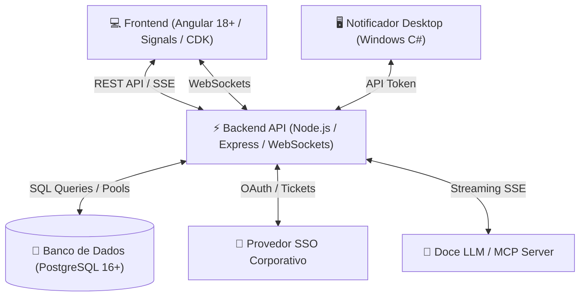

# 🗓️ Agenda Corporativa & Kanban Inteligente

[](https://angular.dev/)
[](https://nodejs.org/)
[](https://www.postgresql.org/)
[](https://www.typescriptlang.org/)
[]()

Uma plataforma corporativa completa e moderna desenvolvida para centralizar a **gestão de tempo, eventos corporativos e tarefas ágeis** em um único ecossistema fluido, colaborativo e de alta performance.

---

## ✨ Principais Funcionalidades

### 📅 1. Calendário Corporativo & Gestão de Eventos
- **Múltiplas Visões:** Navegação intuitiva por mês, semana, dia e visão em lista de compromissos.
- **Recorrência Personalizada:** Agendamento de eventos recorrentes mensais (ex: todo dia 05) com definição flexível de duração em meses.
- **Agendas Múltiplas e Compartilhadas:** Criação de agendas privadas, compartilhadas por departamento ou automáticas por time de trabalho.
- **Seleção Dinâmica de Visibilidade:** Alternância rápida com feedback visual baseado em bordas coloridas temáticas.
- **Feriados & Prazos Automáticos:** Sincronização em tempo real de feriados e vencimentos de tarefas no próprio calendário.

### 📋 2. Quadro Kanban & Gestão de Tarefas
- **Colaboração em Times:** Criação de múltiplos times com quadros compartilhados e gestão de membros/permissões.
- **Drag-and-Drop Fluido:** Reordenação e movimentação suave de cards entre etapas com Angular CDK.
- **Estrutura em Árvore (Subtarefas):** Capacidade de criar ramificações completas de subtarefas dentro de qualquer card.
- **Checklists & Progresso:** Acompanhamento de itens com cálculo automático de porcentagem de conclusão.
- **Central de Anexos:** Upload e pré-visualização de PDFs (leitor integrado) e imagens diretamente no modal da tarefa.
- **Gestão de Lixeira:** Sistema de arquivamento, lixeira com restauração e expiração automática conforme LGPD.

### 🖨️ 3. Sistema de Impressão de Alta Fidelidade
- **Impressão do Kanban Completo:** Layout inteligente em modo paisagem (*landscape*) que redimensiona colunas e cards proporcionalmente, garantindo encaixe perfeito em 1 página sem quebras indesejadas.
- **Ficha de Tarefa Individual:** Impressão em modo retrato (*portrait*) contendo todos os detalhes do card: descrição em Markdown, responsáveis, checklist, etiquetas e metadados.

### 🤖 4. Assistente IA Integrado
- **Chat Inteligente:** Assistente contextual com streaming em tempo real via Server-Sent Events (SSE).
- **Rolagem Inteligente:** Restaura a conversa na última mensagem enviada/recebida ao reabrir.
- **Ações de Texto Rápidas:** Botão de IA nos campos de descrição para expandir, resumir, corrigir ou sugerir checklists automáticos.
- **Integração MCP (Model Context Protocol):** Conexão com ferramentas externas e agentes inteligentes.

### 🎨 5. Sistema de Temas Dinâmicos & Glassmorphism
- **Claro (Light) & Escuro (Dark)**
- **Reino Angelical (Angel Realm):** Efeitos dourados e partículas celestiais em tons claros e escuros.
- **Reino Demoníaco (Demon Realm):** Efeitos de brasas e tons avermelhados profundos.
- **Tema Secreto "Cadu Maverick":** Camada visual personalizada com transparência sobre imagem de fundo.

### 🔔 6. Notificações & Notificador Windows
- **Notificações em Tempo Real:** Atualizações instantâneas via WebSockets e SSE.
- **Notificador Desktop (.exe):** Integração com aplicativo nativo em C# para alertas de prazos na bandeja do Windows.
- **Privacidade & LGPD:** Conformidade com o Art. 18 da LGPD para exportação estruturada e anonimização de dados.

---

## 🏗️ Arquitetura e Tecnologias



### 💻 Frontend
- **Framework:** Angular 18+ (Standalone Components, Signals, RxJS)
- **Componentes & Ícones:** Angular Material, Material Symbols, Angular CDK (Drag and Drop)
- **Estilização:** SCSS Modular, Variáveis CSS Dinâmicas, Backdrop Filter (Glassmorphism)
- **Renderização Markdown:** Suporte nativo a texto formatado e checklists

### ⚙️ Backend
- **Ambiente:** Node.js & Express
- **Banco de Dados:** PostgreSQL (`pg` connection pool) com migrations automatizadas
- **Comunicação em Tempo Real:** WebSockets (`ws`) e Server-Sent Events (SSE)
- **Segurança:** Helmet, Rate Limit, Queries Parametrizadas contra SQL Injection, Sanitização Zod
- **IA & MCP:** `@modelcontextprotocol/sdk` e integração com LLMs corporativos

---

## 🚀 Como Executar o Projeto

### Pré-requisitos
- **Node.js:** Versão 20.x ou superior
- **PostgreSQL:** Versão 15+ instalada e rodando
- **NPM** ou **Yarn**

### 1. Clonar o repositório e configurar variáveis de ambiente
```bash
git clone https://github.com/seu-usuario/dc-agenda.git
cd dc-agenda
```

Crie o arquivo `.env` na raiz do projeto:
```env
# Banco de Dados
PGHOST=127.0.0.1
PGPORT=5432
PGDATABASE=agenda
PGUSER=postgres
PGPASSWORD=sua_senha

# Servidor
PORT=9900
HOST=0.0.0.0

# IA & SSO (Opcional)
SSO_LLM_BASE_URL=http://seu-servidor/sso-llm/api/v1
SSO_LLM_API_KEY=sua_chave_de_api
```

### 2. Configurar o Banco de Dados
```bash
cd backend
npm install
npm run db:setup
```

### 3. Instalar dependências e compilar o Frontend
```bash
cd ../frontend
npm install
npm run build
```

### 4. Iniciar o Servidor
```bash
cd ../backend
npm start
# Ou em modo desenvolvimento com auto-reload:
npm run dev
```

Acesse a aplicação em: `http://localhost:9900`

---

## 📊 Scripts Úteis

| Comando | Descrição |
| :--- | :--- |
| `npm run startdev` | Inicia Frontend + Backend em modo Dev apontando automaticamente para o banco `agenda_dev` |
| `npm run dev` | Inicia em modo Dev apontando para `agenda_dev` com bypass de autenticação local |
| `npm run db:setup:dev` | Cria e atualiza a estrutura de tabelas no banco de desenvolvimento `agenda_dev` |
| `npm run db:setup` | Inicializa as tabelas do PostgreSQL no banco padrão |
| `npm run build` | Compila o frontend Angular para `backend/public/` |
| `npm test` | Executa a suíte de testes automatizados do backend |
| `npm run seed:linkedin` | Popula o banco com a agenda, time e tarefas de apresentação do LinkedIn |

---

## 📄 Licença
Projeto desenvolvido para uso corporativo. Todos os direitos reservados.

